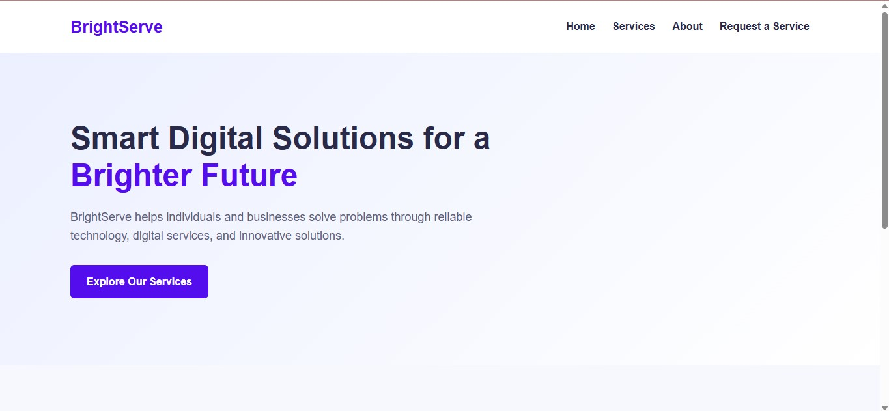
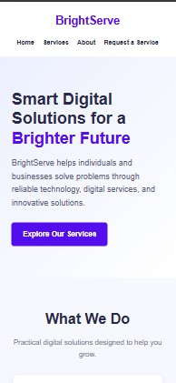

# BrightServe - Digital Services Platform

## 1. Project Overview

BrightServe is a Laravel-based web application designed to help individuals and businesses explore digital services and submit service requests through an online form.

The application provides a structured platform for customers to communicate their service requirements and enables BrightServe personnel to receive and manage submitted requests.

## 2. Problem Statement

Customers seeking digital services may have difficulty communicating their requirements and organizing service requests through informal channels.

BrightServe addresses this problem by providing an accessible website where customers can explore available services and submit their requirements through a structured online form.

## 3. Target Users

- Individuals seeking digital services.
- Small businesses requiring digital solutions.
- BrightServe personnel responsible for receiving and managing service requests.

## 4. Main Features

The current application includes:

- A responsive homepage introducing BrightServe and its services.
- A shared Laravel Blade layout and navigation menu.
- Database-driven homepage service cards displaying active services.
- A service-request form populated dynamically from the database.
- Server-side validation of submitted customer information.
- Customer name validation with a maximum of 100 characters.
- Phone number format validation.
- Message validation with a maximum of 1,000 characters.
- JavaScript message character counter.
- Preservation of previously entered form values after validation errors.
- Success and validation-error messages.
- Database storage of submitted service requests.
- Service-to-booking model relationships.
- Protection against duplicate submissions through the redirect-after-POST workflow.

## 5. Information Collected

The service-request form collects:

- Selected service.
- Customer's full name.
- Phone number.
- Email address (optional).
- Preferred service date (optional).
- Description of the customer's requirements (optional).

## 6. Technology Stack

- PHP 8.3
- Laravel 13
- MySQL 8.4
- Laravel Blade
- HTML5
- CSS3
- JavaScript
- Git and GitHub

## 7. Database Structure and Relationships

The application uses MySQL for data storage.

Main database tables include:

- `services` - stores available digital services.
- `bookings` - stores submitted customer service requests.
- `users` - supports Laravel user functionality.
- Additional Laravel tables for sessions, caching and background jobs.

### Eloquent Relationships

The application uses Laravel Eloquent relationships:

- A booking belongs to a service through the `service()` relationship.
- A service can have multiple bookings through the `bookings()` relationship.

The homepage retrieves active services from the `services` table and displays their names and descriptions dynamically.

## 8. Running the Project Locally

### Prerequisites

Install and configure:

- PHP 8.3 or a compatible version supported by the project.
- Composer.
- MySQL 8.4 or a compatible MySQL version.
- Git.

### Installation

1. Clone the repository:

   ```bash
   git clone https://github.com/Olorunwa2023/brightserve-laravel.git
   ```

2. Enter the project directory:

   ```bash
   cd brightserve-laravel
   ```

3. Install PHP dependencies:

   ```bash
   composer install
   ```

4. Create the local environment file:

   ```bat
   copy .env.example .env
   ```

5. Generate the Laravel application key:

   ```bash
   php artisan key:generate
   ```

6. Create a MySQL database named `brightserve_local`.

7. Configure the database connection in `.env`:

   ```env
   DB_CONNECTION=mysql
   DB_HOST=127.0.0.1
   DB_PORT=3307
   DB_DATABASE=brightserve_local
   DB_USERNAME=root
   DB_PASSWORD=
   ```

   Adjust the port, username and password to match your local MySQL configuration.

8. Run the database migrations:

   ```bash
   php artisan migrate
   ```

9. Ensure the `services` table contains active service records so that the services appear on the homepage and request form.

10. Start the Laravel development server:

    ```bash
    php artisan serve
    ```

11. Open the application:

    `http://127.0.0.1:8000`

### Application Routes

- Homepage: `http://127.0.0.1:8000`
- Service request form: `http://127.0.0.1:8000/request`

### Important Configuration Note

Database settings vary between computers. Use the settings appropriate for your local MySQL server.

Keep your `.env` file private. Never commit database passwords, application secrets or other sensitive configuration information to GitHub.

## 9. Testing and Verification

The application has undergone local functional testing.

The following checks were performed:

1. **Homepage database integration:** Confirmed that active services are retrieved from MySQL and displayed dynamically.
2. **Character counter:** Confirmed that the message counter updates as text is entered and resets when the field is cleared.
3. **Input validation:** Tested an invalid phone number and confirmed that validation prevents the request from being stored.
4. **Old input preservation:** Implemented Laravel's `old()` helper to retain previously entered form information after validation errors.
5. **Successful booking submission:** Submitted fictional customer information and verified that the booking was saved in the database.
6. **Duplicate submission prevention:** Refreshed the redirected request page and confirmed that the booking count remained unchanged.
7. **Database verification:** Used Laravel Tinker to inspect saved booking records and verify the service relationship.

### Screenshots

#### Desktop Homepage



#### Mobile Homepage



## 10. Development Status

### Part 1 - Core Application

Implemented:

- Laravel project setup.
- Database migrations.
- Shared website layout and navigation.
- Homepage and service presentation.
- Service-request form.
- Database-driven service dropdown.
- Booking submission functionality.

### Part 2 - Enhancements and Verification

Implemented and locally tested:

- JavaScript message character counter.
- Service-to-booking Eloquent relationship.
- Database-driven homepage service cards.
- Improved server-side form validation.
- Customer name and message character limits.
- Phone-format validation.
- Previous form-value preservation.
- Invalid and successful booking submission tests.
- Duplicate-submission verification.
- Desktop and mobile homepage screenshots.

## 11. GitHub Repository

Repository:

https://github.com/Olorunwa2023/brightserve-laravel

Main development branch: `main`

## 12. Project Conclusion

BrightServe demonstrates the development of a database-driven digital services platform using Laravel, PHP, MySQL and JavaScript.

The application provides customers with a structured way to explore services and submit service requests, supported by server-side validation, persistent database storage and responsive homepage presentation.

The project provides a foundation for future improvements, including administrative booking management, customer communication and additional digital service features.

## 13. License

This project was developed as a Laravel web-development capstone project.